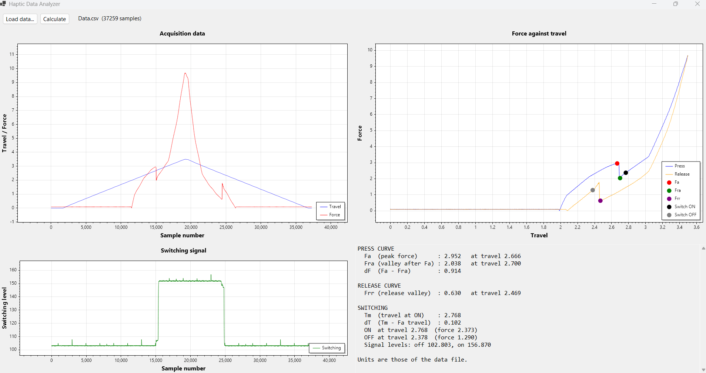

# Haptic Data Analyzer

A Windows desktop application written in C# that loads data recorded while pressing a push button switch, plots it, and calculates the haptic characteristics of the switch: the actuation force, the force after the click, the release force and the switching point.

## Overview

When a push button is pressed, force builds up, the button clicks, and then the force rises again as it reaches its end stop. This "click" is what a user feels, and it is measured as a force against travel curve. The program reads a recording of one press and release cycle, shows it in charts, and extracts the numbers that describe the feel of the switch.
## Result


## Features

- Loads acquisition data from a CSV file (travel, force and switching signal)
- Plots the raw data against sample number
- Plots the switching signal on its own chart
- Plots force against travel, with the press and release curves drawn separately
- Calculates Fa, Fra, Frr, Tm and the switching points
- Marks the calculated points on the force against travel chart
- Shows the results as text, with clear error messages if the file cannot be read or no click is found

## Tools and technologies

| Tool | Use |
|---|---|
| C# | Programming language |
| .NET 10 (`net10.0-windows`) | Runtime and build tools |
| Windows Forms | Desktop user interface |
| ScottPlot 5 | Free, open source charting library (NuGet package `ScottPlot.WinForms`) |
| Visual Studio Code / Visual Studio | Development environment |

## Project structure

| File | Contents |
|---|---|
| `HapticApp.csproj` | Project settings: Windows Forms application, target framework and the ScottPlot package reference |
| `Program.cs` | Entry point. Starts the application and opens the main window |
| `MainForm.cs` | User interface: the Load and Calculate buttons, the three charts and the results box. It draws the charts and marks the points |
| `HapticAnalysis.cs` | Logic with no user interface code: reading the CSV file and calculating the haptic characteristics |

### Classes in `HapticAnalysis.cs`

| Class | Purpose |
|---|---|
| `Recording` | Holds the three loaded columns: travel, force and switching |
| `CsvLoader` | Reads the CSV file into a `Recording` |
| `HapticCalculator` | Smooths the force and finds the peak, the valleys and the switching points |
| `HapticResult` | Holds all calculated values so the window can display them |

The calculation is kept separate from the window on purpose. It can be reused or tested without a user interface, and the chart library can be replaced by changing only `MainForm.cs`.

## Input data format

A comma separated file with a header line and three columns, in this order:

```
Enocder,Force,Switching
0,0.0918,102.90
0,0.0923,102.87
...
```

- **First column:** travel (position of the plunger). The header in the sample file is spelled `Enocder`; the program skips the header line, so the spelling does not matter.
- **Second column:** force.
- **Third column:** the switching signal. It has two levels, one when the switch is off and one when it is on.
- One press and release cycle per file. Units are not stored in the file.

## How the calculation works

1. **Load.** The file is read line by line. Numbers are parsed with the invariant culture, so a decimal point is read correctly on any system language.
2. **Smooth.** The force is smoothed with a 61 sample moving average to remove sensor noise.
3. **Split press and release.** The sample with the largest travel is the turning point. Samples before it are the press, and samples after it are the release.
4. **Find peaks and valleys.** The program walks along the curve and remembers the highest (or lowest) value so far. A peak or valley is confirmed when the force has moved back by at least 0.3 (`minStep`), so noise does not create false points.
5. **Find the switching points.** The threshold is the midpoint between the lowest and highest switching values. The ON point is the first upward crossing on the press, and the OFF point is the first downward crossing on the release.

### Calculated values

| Value | Meaning |
|---|---|
| **Fa** | Peak force of the press curve (the force needed to make the switch click) |
| **Fra** | Force at the valley after the peak on the press curve |
| **Frr** | Force at the valley on the release curve |
| **dF** | Fa minus Fra, the size of the click |
| **Tm** | Travel at which the switch turns on |
| **dT** | Tm minus the travel of the force peak |
| **Switching** | ON and OFF points (travel and force) and the two signal levels |

Fa, Fra and Frr are taken from the smoothed curve, so they can be slightly lower than the raw maximum.

## Getting started

### Requirements

- Windows 10 or 11
- [.NET 10 SDK](https://dotnet.microsoft.com/download)

### Build and run

```
git clone https://github.com/Medferhy/Haptic-Data-Analyzer.git
cd Haptic-Data-Analyzer
dotnet run
```

The first run downloads the ScottPlot package, so an internet connection is needed.

### Usage

1. Click **Load data...** and choose a CSV file.
2. The three charts are drawn.
3. Click **Calculate** to show the haptic characteristics and mark them on the force against travel chart.

## Example result

For the sample recording used during development (about 37,000 samples), the program gives approximately:

| Value | Result |
|---|---|
| Fa | 2.95 at travel 2.67 |
| Fra | 2.04 at travel 2.70 |
| Frr | 0.63 at travel 2.47 |
| Tm | 2.77 (dT about 0.10) |
| Switch ON / OFF | travel 2.767 / 2.378 |

## Author

Mohamed Ferhi
